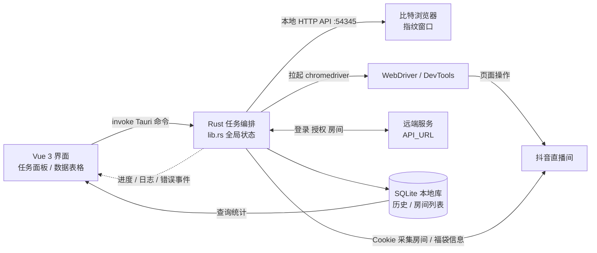

# qfd · 小桔福袋助手

> 🚀 推荐：[**KokoVPN**](https://kokovpn.com/) — 稳定好用的 VPN，源码见 [GitHub](https://github.com/sparksisnotspark/kokovpn)。

抖音直播间福袋 / 红包自动参与工具，基于 **Tauri 2 + Rust + Vue 3** 的 Windows 桌面应用。
程序通过 [比特浏览器](https://www.bitbrowser.cn/)（BitBrowser）指纹浏览器的本地 API 批量拉起窗口，
再用 `chromedriver` 接管页面，按配置条件自动完成直播间福袋 / 红包的参与。

> 本项目仅供技术学习与研究使用。使用前请自行确认并遵守目标平台的服务条款，风险自负。

## 功能特性

- **多窗口批量管理**：读取比特浏览器分组，批量打开 / 关闭 / 重启窗口；窗口异常退出自动重拉并恢复任务。
- **多线程房间采集**：按在线人数等条件并发拉取目标直播间列表，结果写入本地库。
- **自动参与**：解析直播间福袋 / 红包 lottery 信息，按「仅大包、加入粉丝团、参与人数上限、中奖率、最小钻石 / 平均钻石」等条件过滤后自动参与。
- **账号 Cookie 管理**：广场 Cookie 批量导入（一行一个），本地持久化，支持全选删除。
- **数据统计**：每个窗口的参与数、中奖数、获得钻石等实时入库，界面表格展示并支持合计、筛选、分页、自动刷新。
- **授权与设备绑定**：登录 / 注册 / 解绑 / 续费走远端授权服务，按机器码绑定设备、校验 Token 有效期。
- **实时日志**：任务进度、错误与提示通过 Tauri 事件推送到前端，窗口状态一目了然。

## 技术栈

| 层次 | 技术 |
| --- | --- |
| 桌面框架 | Tauri 2（`tauri-plugin-store` / `dialog` / `sql` / `opener` / `machine-uid`）+ 官方 JS 插件 |
| 后端 | Rust 2021、`tokio`、`reqwest`、`thirtyfour`（WebDriver）、`rusqlite`、`serde` |
| 前端 | Vue 3（`<script setup>`）、Vue Router 4、Pinia、Element Plus、Axios |
| 数据 | SQLite（`tauri-plugin-sql`）经 Drizzle ORM `sqlite-proxy` 访问，表结构在运行时由 `init_sqlite_db` 建立 |
| 构建 | Vite 6、pnpm、`@tauri-apps/cli` |

## 目录结构

```
qfd/
├─ index.html               入口 HTML
├─ vite.config.js           Vite 配置（端口 1420）
├─ package.json             前端依赖与脚本
├─ src/                     Vue 3 前端
│  ├─ main.js               应用挂载
│  ├─ MyApp.vue             根组件：全局事件、关窗确认
│  ├─ router.js             路由与登录守卫
│  ├─ store.js              Pinia 全局状态（登录态，持久化到 app.json）
│  ├─ api.js                远端接口封装 + SQLite 初始化 / 历史记录读写
│  ├─ db/                   Drizzle schema 与数据库连接
│  └─ pages/
│     ├─ tasks.vue          主界面：详细数据 + 任务面板
│     ├─ login.vue          登录 / 注册
│     ├─ cookie.vue         Cookie 输入
│     └─ records.vue        记录页
└─ src-tauri/               Rust 后端
   ├─ tauri.conf.json       窗口、插件、打包配置
   └─ src/
      ├─ main.rs            二进制入口
      ├─ lib.rs             Tauri 命令、全局状态、任务编排（自动化主流程）
      ├─ bit.rs             比特浏览器 API 调用 + chromedriver / WebDriver 页面操作
      ├─ gather.rs          直播间与福袋信息采集、远端房间接口
      ├─ threads.rs         多线程采集调度
      ├─ history_db.rs      历史数据入库 / 查询
      └─ room_list_db.rs    直播间列表本地缓存
```

## 架构与任务流程



一个任务的生命周期：选择比特浏览器分组 → 批量打开窗口并拿到调试地址 → 为每个窗口启动 chromedriver 建立 WebDriver 会话 →
采集直播间并解析福袋 / 红包信息 → 按条件自动参与 → 结果写入 SQLite 并推送事件到界面 → 窗口异常时自动重拉、继续任务。

## 运行与构建

环境要求：**Node.js 18+ / pnpm**、**Rust stable**、Windows 需安装 **WebView2** 运行时；
实际执行任务时还需本机安装并运行**比特浏览器**，且开启其本地 API（默认 `127.0.0.1:54345`）。

```bash
pnpm install          # 安装前端依赖
pnpm tauri dev        # 开发模式（Vite + Rust 热更新）
pnpm tauri build      # 打包安装包 / 可执行文件
```

常用辅助命令：

```bash
pnpm dev              # 仅启动前端
pnpm build            # 仅构建前端资源
pnpm tauri            # 透传 Tauri CLI（如 pnpm tauri icon）
```

> 数据库表结构无需手动迁移：前端启动时由 `src/api.js` 的 `init_sqlite_db` 执行 `CREATE TABLE IF NOT EXISTS`。

## 配置说明

- **远端服务地址**：`src/api.js` 中的 `API_URL`（授权、房间、版本接口），本地调试可切到 `http://127.0.0.1:8787`。
- **窗口信息**：`src-tauri/tauri.conf.json` 中的 `productName`（XiaoJu）、标题「小桔福袋助手」与窗口尺寸。
- **任务参数**：均在「任务面板」中配置——浏览器分组、任务类型（红包 / 福袋）、循环运行、下发次数等。

## 免责声明

本项目仅用于**技术学习与研究**，不得用于任何违反法律法规或第三方平台规则的用途。
使用者应自行承担因使用本软件产生的全部风险与后果（包括但不限于账号封禁、数据丢失、经济纠纷）。
作者不对任何直接或间接损失负责。

## License

未声明许可证；如需使用请联系仓库所有者。
